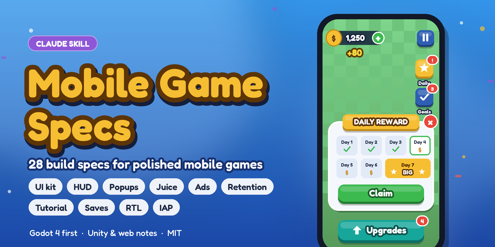

<p align="center"></p>

# mobile-game-specs — a Claude skill for building mobile games

> Reusable specs for building polished mobile games with Claude: UI, feel, ads, retention,
> notifications, store features, testing. Examples lean toward idle/tycoon games (customers,
> workers, stations); each file's "When to use it" says how to adapt it to other genres.

Version 1.0.0 · [Changelog](CHANGELOG.md) · [License](LICENSE)

**28 short build specs** for the systems almost every mobile game needs: a design language, chunky buttons with count
badges, ribbon popups, the HUD layout, coins that fly into the counter, juice, touch controls, splash and menu,
settings, ads that don't drive players away, rating and notification prompts, daily rewards, a DEV panel, saves with
anti-cheat, tutorials, Arabic/Hebrew RTL, accessibility and performance budgets. Each spec gives **default values with
reasons**, **rules**, a **Godot 4 implementation outline** (with Unity/web notes) and a **"Done when" checklist**.

Claude asks before it builds: it confirms the game needs the system, shows the defaults, asks only the spec's
questions, remembers your answers, then proves every checklist item with tests and screenshots.

## Install

**Claude Code**
```bash
git clone https://github.com/Suleiman700/claude-mobile-game-specs ~/.claude/skills/mobile-game-specs
```
For one game only, clone into `<project>/.claude/skills/mobile-game-specs`, or copy the spec files into the game's
`docs/game-prompts/` to customize them there (project copies override the library).

**Claude app:** download this repo as a ZIP and upload it as a skill in the app's settings.

Then ask for what you need: *"start a new idle tycoon game"*, *"add daily rewards"*, *"set up ads"*,
*"build the settings screen"*.

## Review what you built

Pairs with [claude-harsh-design-critic](https://github.com/Suleiman700/claude-harsh-design-critic). After building, the
screenshots go to the critic, which measures every screen against these specs and your confirmed values, marks each
issue on the image, and turns it into an approvable fix:

<p align="center">
  
  
</p>

## What this is

A library of short design-and-build guides. Each file covers **one system** that most mobile games
need (popups, money feedback, ads, daily rewards, notifications, tutorial...). Each one explains
**what** the system is, **why** it matters, **which games** need it and **when** it appears, then
gives **default values**, **rules** and an **implementation outline**.

The defaults come from patterns that work in top Play Store arcade, idle and casual games. They are
starting points: every game confirms or changes them.

## Why it exists

Every new game needs the same 20+ systems, and they're easy to get subtly wrong (ads at the wrong
moment, popups that stack, invisible touch controls, a tutorial that replays for returning
players). Writing them down once means:
- no re-explaining the same requirements to Claude for each project
- the same quality bar in every game
- decisions made once, with their reasons, and reused

## How to use it with Claude

Point Claude at the files you want applied, for example:

> Read `docs/game-prompts/README.md` and `docs/game-prompts/11-ads.md`, and apply it to this game.

Every file has a **"Before you build (for Claude)"** section. Claude must:

1. **Confirm the game needs it.** Not every system fits every genre (a puzzle game may skip floor
   price tags; a premium game skips ads). If unsure, ask.
2. **Show the Defaults table** and ask *"Use these values, or change any?"*, then wait. You can
   change values in chat ("interstitial every 8 purchases", "no banner on the menu").
3. **Ask only the listed questions** (palette, game name, product ids...). Everything else follows
   the file.
4. **Build it**, then check the file's **Done when** list with tests and screenshots
   (`17-testing-and-screenshots.md`).

Claude must not install third-party plugins or SDKs without reviewing them with you first.

## Using it as a Claude skill

Install it as shown above. Then just
ask for the feature: *"add daily rewards to this game"*, *"build the settings screen"*, *"set up ads"*. The skill
picks the right files from the genre table below and follows the four steps above.

- **Your answers are remembered.** Confirmed values (palette, ad cadence, product ids...) are written to
  `docs/game-prompts/project-decisions.md` in the game's repo, so Claude never asks the same question twice.
- **Your project can override the library.** Copies of these files placed in the game's `docs/game-prompts/` win over
  the skill's copies.
- **Reviewing what was built.** With the `harsh-design-critic` skill installed, the screenshot step hands the captures to
  the critic, which grades the screens against these specs and `project-decisions.md`.

## Files

| # | File | What |
|---|---|---|
| 01 | [design-language](01-design-language.md) | Palette tokens, font, type scale, spacing, safe area |
| 02 | [buttons-and-badges](02-buttons-and-badges.md) | Chunky buttons, styles, states, square side buttons, count badges |
| 03 | [popups](03-popups.md) | Ribbon popups, unlock reveal, bottom sheet, toast |
| 04 | [hud-layout](04-hud-layout.md) | Where everything sits on the game screen; floating labels |
| 05 | [money-feedback](05-money-feedback.md) | Coins fly in, "+X" gold up, "−X" red down |
| 06 | [feel-sound-haptics](06-feel-sound-haptics.md) | Press bounce, pulse, confetti, sound map, vibration |
| 07 | [touch-controls](07-touch-controls.md) | On-screen controls every mobile game needs |
| 08 | [splash-screen](08-splash-screen.md) | Boot, studio logo, loading |
| 09 | [main-menu](09-main-menu.md) | Live backdrop, logo, Play/Continue, Settings, optional More Games |
| 10 | [settings](10-settings.md) | Sliders, vibration, language, privacy, version |
| 11 | [ads](11-ads.md) | Banner, rewarded placements, interstitials after purchases |
| 12 | [rate-prompt](12-rate-prompt.md) | "Enjoying?" → in-app review |
| 13 | [notifications](13-notifications.md) | Gentle permission ask, local reminders |
| 14 | [firebase-push-topics](14-firebase-push-topics.md) | Push messages to player groups |
| 15 | [retention](15-retention.md) | Daily reward, goals, gifts, offline earnings, special customers |
| 16 | [dev-panel](16-dev-panel.md) | DEV button with test shortcuts (debug builds only) |
| 17 | [testing-and-screenshots](17-testing-and-screenshots.md) | Tests, real-flow screenshots, UI audit |
| 18 | [privacy-consent](18-privacy-consent.md) | Consent before ads/analytics, privacy options |
| 19 | [iap-remove-ads](19-iap-remove-ads.md) | In-app purchases, Remove Ads, restore |
| 20 | [analytics](20-analytics.md) | Events worth tracking, consent-gated |
| 21 | [localization-rtl](21-localization-rtl.md) | Translations, right-to-left languages |
| 22 | [saves-and-anti-cheat](22-saves-and-anti-cheat.md) | Safe saves, migrations, tamper checks |
| 23 | [tutorial-onboarding](23-tutorial-onboarding.md) | First session, teaching by doing, resuming |
| 24 | [android-lifecycle](24-android-lifecycle.md) | Back button, pause/resume, save on exit |
| 25 | [feature-switches](25-feature-switches.md) | Turn systems on/off per game |
| 26 | [accessibility](26-accessibility.md) | Text size, contrast, color-blind safety |
| 27 | [performance](27-performance.md) | Budgets for low-end phones |
| 28 | [upgrades-and-unlocks](28-upgrades-and-unlocks.md) | Upgrade rows, unlocks, buy-by-standing price tags |

Looking for the **pause menu**? It's in `03` (typical popups). **Crash reporting** is in `20`.

Store publishing (listing text, privacy policy, Data safety form) is **out of scope** for this library; follow
Google Play's and Apple's own publishing docs.

## Which files for which game

| Genre | Core files | Usually also |
|---|---|---|
| Arcade-idle / tycoon (walk around, buy stations) | 01–07, 09, 10, 15, 16, 23, 28 | 11, 12, 13, 19 |
| Idle clicker (no walking) | 01–06, 09, 10, 15, 16, 23, 28 | 11, 12, 13 |
| Action / shooter / runner | 01–03, 06, 07, 09, 10, 16, 23 | 05, 11, 12, 15 |
| Puzzle / casual levels | 01–03, 05, 06, 09, 10, 16, 23 | 11, 12, 13, 15 |
| Every game shipping on Android | 08, 17, 18, 22, 24, 26, 27 | 20, 21, 25 |

## Order for a new game

1. Look and feel: 01–07
2. Menus: 09, 10, 08
3. Core retention and onboarding: 15, 23, 28
4. Money: 18 (consent), 11 (ads), 19 (purchases)
5. Coming back: 12, 13, 14, 20
6. Tools and quality: 16, 17
7. Polish and safety: 21, 22, 24–27

## Conventions

- **Defaults** tables: `Setting | Default | Why`. Values in `code` are the ones to confirm.
- **Rules** apply unless the user explicitly overrides them.
- Sizes are canvas pixels of a **720×1280 portrait** layout that stretches to any phone; adapt for
  landscape games.
- Implementation notes are written for **Godot 4 (GDScript)** first, with notes for other engines.
- Money examples use `$`; use the game's own currency symbol.
- **Touch targets:** every tappable area is at least `88×88` canvas px; a smaller visible shape gets invisible padding.
- **One ask per session:** the notification soft-ask, rate prompt and starter pack share one slot (`03`, Ask budget).
- **Disabled vs hidden:** can't do it *yet* → visible and disabled; feature unavailable *right now* → hidden (`02`).
